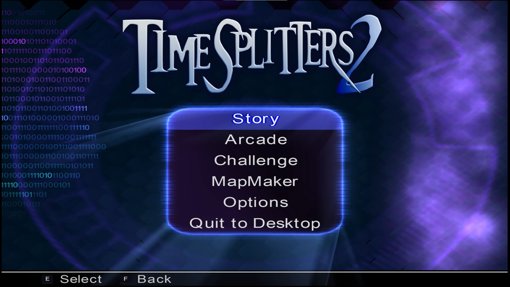
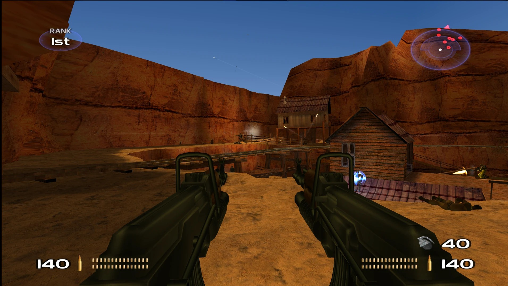
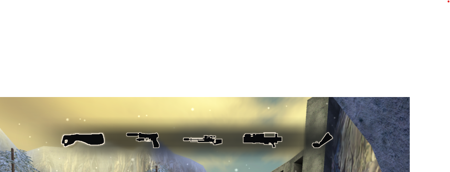
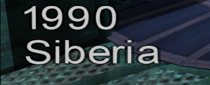

# TimeSplitters 2 - XBE Recomp

An unofficial native PC port of **TimeSplitters 2** (Xbox, USA release), made by static recompilation of the game's `default.xbe`, with a Direct3D 12 renderer, mouse and keyboard, modern controller support and a number of fixes and extras over the original.

Built with the [Xbox XBE Recomp](https://github.com/TGP482/XboxXBE-Recomp) tool.

> [!NOTE]
> This project does not include the game. You must provide your own legally acquired copy of the **USA Xbox** version (an `.iso`, or the extracted files). Other regions or versions are not supported: the launcher checks the `default.xbe` of the image and refuses a different one.

## Screenshots

| | |
|---|---|
|  |  |
| Redesigned wide-screen main menu, with the big logo and a Quit to Desktop line | Gameplay with the larger ammunition display |
|  |  |
| The Future Perfect style weapon bar | HD text for the level captions |

## Installation

1. Download the release zip and extract it anywhere.
2. Run `TS2Launcher.exe`. Press **Seleccionar ISO USA...** and pick your ISO (or put the extracted game files, `default.xbe` first, in the `assets` folder).
3. Press **JUGAR**.
4. In game, **F1** opens the settings panel (Back + Start on a pad).

The launcher has five pages: Play, Options, Profiles, MapMaker maps and Updates (new versions are published as GitHub releases and installed from there).

### What is different from the original
- Keyboard and mouse as the first player's pad, every key rebindable (primary and alternate). True 1:1 raw-input mouse aim, with separate sensitivity, vertical speed and aim speed; the mouse also works in the front end's menus.
- Xbox, PlayStation and Switch controllers, hot plugging, rumble, and optional gyro aiming (DualSense, DualShock 4, Switch Pro).
- Per-axis speed for the stick and the mouse, adjustable crosshair sway.
- Button prompts drawn as the buttons of the input in use (keyboard, Xbox, PlayStation, Switch), and the game's A and Y button pictures drawn the right way up.
- Typing on the profile name screen with the PC keyboard.
- Free camera (F6) for looking around a level.
- Options that change the game's balance or look are off by default, so the defaults behave like the original:
  Rocket Launcher in every Story level, infinite health, one-hit kills, always-shown crosshair, TimeSplitters 1 health bar, and **TS2 Beta Weapons**.
- An **Unlock Everything line in Player Options, and a **Quit to Desktop** line in the main menu.
- TS2 Beta Weapons replaces the gun models with the beta weapons from `resourcepacks/beta_weapons/gun.pak` (only the gun models; no level is touched). The release includes that pak.

### Display
- **Display Mode:** Fullscreen, or Windowed. The monitor it opens on can be chosen.
- **Resolution:** the output's size, defaulting to your desktop resolution instead of the original 640x480.
- **Aspect Ratio:** the screen's own, or 4:3, 16:9, 16:10, 21:9 or 32:9. The 3D view widens at the same vertical angle and the HUD pictures stay at the shape they were made for, at the screen's edges. Bars appear only where the chosen shape does not fit the window.
- **Internal Resolution:** from the console's own 480 lines up to 5K (2880p), the highest it goes: Original, Native (the window's own pixels), 720p, 1080p, 1440p, 2160p and 2880p. The scene is drawn at that size and scaled to the output.
- **Field of View:** 60 to 100 degrees (the original is 60).
- **V-Sync:** reduces screen tearing. 
- **HDR Output:** HDR10 when Windows HDR is on.
- **Performance Overlay:** frames a second and where each frame's time goes, optionally saved in the log.
- **Menus, Loading Screens and Movies:** stretched to the screen's shape instead of 4:3 with bars.
- **Cutscenes Without Black Bars:** the cutscenes' bars are not drawn and the picture fills the screen.
- **Language:** the console's language the game reads at start.
- Performance overlay and logging (frames a second, where each frame's time goes).

### Graphics
- **MSAA:** 2x, 4x or 8x multisampling on the scene.
- **Subpixel Morphological Antialiasing (SMAA):** enables SMAA to smooth jagged edges across the whole frame with a softer image. SMAA also smooths alpha-tested edges such as fences and foliage, and can be combined with MSAA. FXAA is   there as a lighter alternative.
- **Anisotropic Filtering:** 2x to 16x forced on every texture, or as the game asks.
- **Depth and Seams:** depth rounded to the console's units so nearly flat surfaces tie as they did on the Xbox (no flicker), and conservative rasterization so there are no see-through cracks between pieces of level geometry.
- **Picture:** brightness, saturation and contrast.
- **Fog:** can be turned off, and the scene is then drawn clear to the far plane.
- **Console Effects:** heat shimmer around fire, the soft atmosphere filter, motion trails and the extra rain and snow trails, each can be switched on or off.
- **Smooth Lighting:** - the lights that follow models and the light of particles are kept across frames.
- **HUD options:** ammunition display larger and lower, tall health and shield arcs, crosshair always shown, a TimeSplitters 1 style health bar, and a weapon bar like Future Perfect's.
- HD front-end pictures and HUD pieces (TS2 Redux, bekoha), in the release as `hd_textures.bin` and `hd_hud.bin`.

### Multiplayer
There is no online service: the game's System Link (its local network mode) runs on the PC's network, and Xbox Live does not work (its servers no longer exist).
- **LAN:** games are found by broadcast, as on the Xbox, in System Link games of up to 16 players.
- **Join IP:** a host outside your LAN can be reached by typing its address.
- **VPN:** the broadcast also goes out of every adapter, so players on Radmin, Hamachi or ZeroTier find each other's games.
- **Host and Join:** one player hosts and relays the traffic of the others, so only the host's port must be reachable (UPnP asks the router for it) and the joiners need to open nothing.

### Restored content
- Hidden Arcade maps **Dam** and **Wild West** opened in the Arcade list.
- The MapMaker's cut **Gothic tileset**, MapMaker Story maps playable by every connected controller (up to four) and the MapMaker's memory caps lifted.
- The cut **Default Gun** (a Desert Eagle) in the Arcade weapon lists.
- Characters that are in the game's tables but not in the Select Character list (Gasmask Special, Consultant, the NeoTokyo pedestrians, X-Ray Skel).

### Launcher
`TS2Launcher.exe` (Dear ImGui, Direct3D 11): a blue theme with the game logo and rotating key art, ISO check and import, the options above, profile and MapMaker map import and export, and updates from GitHub releases (a token can be set for a private repository).

### Tools
`tools/` has the Python scripts used to build this: the HD texture bundles, button icon sheets, language tables, pak inspection.

## System requirements

- Windows 10 or 11, 64-bit
- A GPU with support for Direct3D 12
- Your own copy of TimeSplitters 2 (Xbox, USA)

## Building

1. Clone this repository.
2. Put the extracted game files in `assets` (`default.xbe` with the game's folders beside it).
3. Install Visual Studio 2022 with **Desktop development with C++**, **C++ Clang tools for Windows** and **C++ CMake tools for Windows** (`build.bat` offers to add the last two).
4. Run `build.bat`. The first build recompiles the game and takes a while. The exe and the launcher are written to `out\build\release`.
5. `release.bat` builds the release zip.

## Credits

- [Xbox XBE Recomp](https://github.com/TGP482/XboxXBE-Recomp), the recompiler and runtime this is built on.
- [XenonRecomp](https://github.com/hedge-dev/XenonRecomp) for the overridable function layout and instruction hooks.
- [Zydis](https://github.com/zyantific/zydis), [toml++](https://github.com/marzer/tomlplusplus), [Dear ImGui](https://github.com/ocornut/imgui) and [SDL](https://github.com/libsdl-org/SDL).
- TS2 Redux (https://github.com/HFTSRedux/TS2Redux) and bekoha (https://bekoha.github.io/ts2/) for the HD pictures, fonts and HUD pieces.

The full list of credits is in [CREDITS.md](CREDITS.md). TimeSplitters 2 belongs to its rights holders; this is a fan project and is not affiliated with them.

## Windows and antivirus warnings

The executables are not code-signed, so Windows SmartScreen may say "unknown publisher" the first time, and Windows Defender or another antivirus may flag them by mistake. This is common with small open-source projects, and the usual way out is to allow the file or add the game's folder as an exception. The code is public in this repository and the release zip is made from it with `release.bat`.

The launcher connects to GitHub to check for and download new versions, and the game itself has no online service.

## License

The code of this port (everything outside `sdk/`) is under the GNU General Public License v3, see [LICENSE](LICENSE). The SDK in `sdk/` keeps its own MIT license. This does not cover the game itself, its data or the HD pictures, fonts and icons by others: those keep their owners' terms (see [CREDITS.md](CREDITS.md)).
